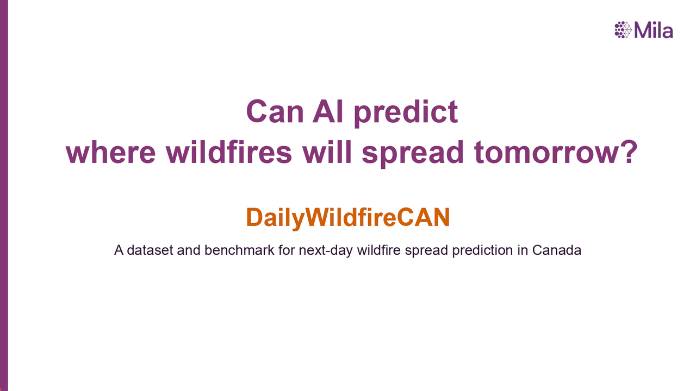

<video width="85%" autoplay loop muted playsinline controls poster="assets/dailywildfirecan_explainer.gif">
  <source src="assets/dailywildfirecan_explainer.mp4" type="video/mp4">
  
</video>

<b>DailyWildfireCAN Dataset and Benchmark.</b> 
<b>(a) Geographic coverage.</b> Locations of the 2,440 wildfires (2017–2024), with marker size indicating total burned area. Bars show the number of fires per year. The inset shows one data sample with its burned area within a 23.04 × 23.04 km tile at 90-m resolution. 
<b>(b) Input features.</b> The 33 input features for the example tile, grouped by data source. Each group indicates the number of features, source dataset, native spatial resolution and temporal frequency. 
<b>(c) Daily Fire Progression.</b> Evolution of an example fire from 16 to 18 July 2024. Dark grey indicates previously burned areas, while orange indicates newly burned areas on each day. The newly burned area on day <i>T</i>+1 constitutes the prediction target. 
<b>(d) Benchmark.</b> Input features available up to day <i>T</i> are used to predict the newly burned area on day <i>T</i>+1. Predictions are evaluated against the observed target using precision, recall and area under the precision–recall curve (AUC-PR).

 

## Abstract

<b>DailyWildfireCAN</b> is a comprehensive dataset and benchmark for next-day wildfire spread prediction across Canada. It combines high-resolution fire progression data with environmental and satellite observations to support the development and evaluation of AI models for wildfire forecasting.

<b>Key Highlights:</b>

<ul>
<li><b>Nationwide coverage:</b> 2,440 wildfire events across eight fire seasons (2017–2024).</li>
<li><b>High resolution:</b> Daily fire progression at 90 m spatial and 24-hour temporal resolution.</li>
<li><b>Multi-modal data:</b> 33 features covering weather, terrain, vegetation, forest structure, human influence, and satellite imagery.</li>
<li><b>Two dataset formats:</b> Mono-temporal and multi-temporal inputs for predicting next-day wildfire spread as a pixel-wise segmentation task.</li>
<li><b>Comprehensive benchmark:</b> Diverse AI models evaluated using standardized data splits, baselines, and protocols.</li>
<li><b>Robustness analysis:</b> Evaluation across fire characteristics, geographic regions, temporal conditions, spatial tolerances, and label uncertainty.</li>
<li><b>Open research resources:</b> Publicly available raw and processed datasets, benchmark implementations, trained checkpoints, and evaluation code.</li>
</ul>

## Dataset and Benchmark

- **Dataset:** raw per-fire data and prepared mono-temporal and multi-temporal ML datasets on [Hugging Face](https://huggingface.co/datasets/DailyWildfireCAN/DailyWildfireCAN).
- **Benchmark:** benchmark models and trained checkpoints on [Hugging Face](https://huggingface.co/DailyWildfireCAN/DailyWildfireCAN-Benchmark).
- **Code:** code for building the dataset, training the benchmark models, and evaluation on [GitHub](https://github.com/milatechtransfer/DailyWildfireCAN).

## Authors



  
  
  
  {{ person.name | slice: 0 }}
  
  
  <a href="{{ person.url | relative_url }}">{{ person.name }}</a>
  
  {{ person.name }}
  
  {{ person.title | replace: '&', ' ' }}





  
  
  
  {{ person.name | slice: 0 }}
  
  
  <a href="{{ person.url | relative_url }}">{{ person.name }}</a>
  
  {{ person.name }}
  
  {{ person.title | replace: '&', ' ' }}



For inquiries, please contact us at:
<a href="mailto:mahacine.ettahri@etud.polymtl.ca">mahacine.ettahri@etud.polymtl.ca</a> (Mahacine Ettahri) or
<a href="mailto:hager.radi@mila.quebec">hager.radi@mila.quebec</a> (Hager Radi)

## Citation

Please cite our preprint:

@article{dailywildfirecan,
  title={DailyWildfireCAN: A Dataset and Benchmark for Next-Day Wildfire Spread Prediction in Canada},
  author={Ettahri, Mahacine and Abdelwahed, Hager Radi and Olutayo, Toluwaleke and Aloise, Daniel and Caron, Ga{\'e}tan Marceau},
  journal={arXiv preprint arXiv:2611.14207},
  year={2026}
}

<i>Developed at Mila: Quebec AI Institute, The Applied Research Team</i>

  

