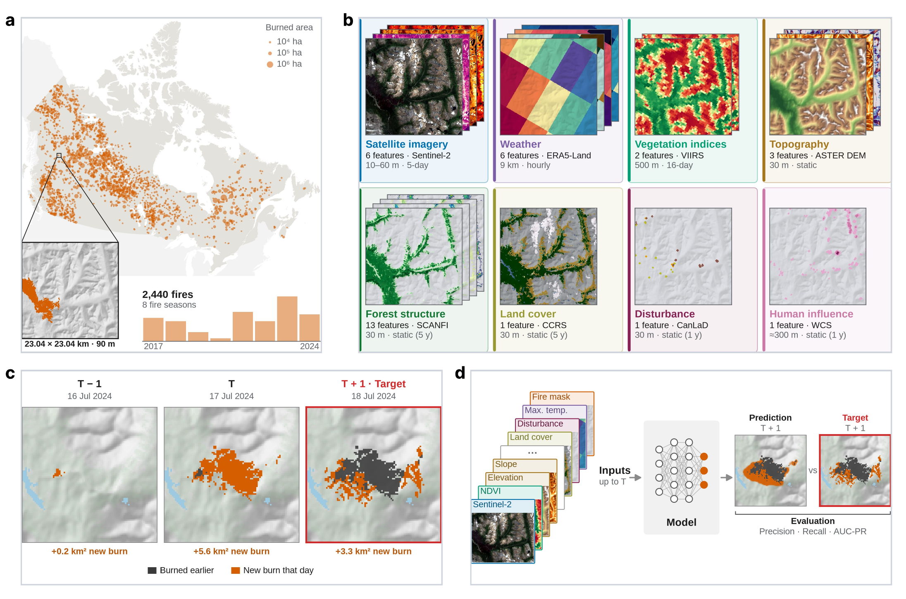

 

<b>DailyWildfireCAN Dataset and Benchmark.</b>
<b>(a) Geographic coverage.</b> Locations of the 2,440 wildfires (2017–2024), with marker size indicating total burned area. Bars show the number of fires per year. The inset shows one data sample with its burned area within a 23.04 × 23.04 km tile at 90-m resolution.
<b>(b) Input features.</b> The 33 input features for the example tile, grouped by data source. Each group indicates the number of features, source dataset, native spatial resolution and temporal frequency.
<b>(c) Daily Fire Progression.</b> Evolution of an example fire from 16 to 18 July 2024. Dark grey indicates previously burned areas, while orange indicates newly burned areas on each day. The newly burned area on day <i>T</i>+1 constitutes the prediction target.
<b>(d) Benchmark.</b> Input features available up to day <i>T</i> are used to predict the newly burned area on day <i>T</i>+1. Predictions are evaluated against the observed target using precision, recall and area under the precision–recall curve (AUC-PR).

 

## Abstract

We present <b>DailyWildfireCAN</b>, a multi-modal, multi-temporal dataset and benchmark for predicting next-day wildfire spread across Canada. The dataset tracks continuous fire progression over multi-day events at a high spatial and temporal resolution of 90 m and 24 h, respectively. This resolution preserves fine-scale information relevant to fire-edge geometry, local fuel variations, and terrain effects, supporting research toward improved daily wildfire spread forecasting. DailyWildfireCAN covers 2,440 wildfire events across eight fire seasons (2017–2024) and integrates 33 features across diverse modalities, including topography, meteorology, vegetation and forest structure, human influence indices, and satellite imagery. We establish a comprehensive benchmark comparing mono-temporal and multi-temporal prediction models, accompanied by a multi-dimensional evaluation framework assessing robustness across wildfire characteristics, geographic regions, and temporal conditions, spatial prediction quality, and sensitivity to reference label variations. Together, the dataset and evaluation framework provide a standardized foundation for identifying model limitations and advancing wildfire spread prediction in Canadian landscapes. We publicly release the dataset including raw data, mono-temporal and multi-temporal formats, along with benchmark models, trained checkpoints, and comprehensive evaluation code.

## Dataset and Benchmark

The dataset is available for [download](https://huggingface.co/datasets/DailyWildfireCAN/DailyWildfireCAN), and we release the [code](https://github.com/hagerradi/DailyWildFireCAN) for building the dataset in other regions of the world and for the benchmark.

- **Dataset:** raw per-fire data and prepared mono-temporal and multi-temporal ML datasets on [Hugging Face](https://huggingface.co/datasets/DailyWildfireCAN/DailyWildfireCAN).
- **Benchmark:** benchmark models and trained checkpoints on [Hugging Face](https://huggingface.co/DailyWildfireCAN/DailyWildfireCAN-Benchmark).
- **Code:** code for building the dataset, training the benchmark models, and evaluation on [GitHub](https://github.com/hagerradi/DailyWildFireCAN).

## Authors



  
  
  
  {{ person.name | slice: 0 }}
  
  
  <a href="{{ person.url | relative_url }}">{{ person.name }}</a>
  
  {{ person.name }}
  
  {{ person.title | replace: '&', ' ' }}





  
  
  
  {{ person.name | slice: 0 }}
  
  
  <a href="{{ person.url | relative_url }}">{{ person.name }}</a>
  
  {{ person.name }}
  
  {{ person.title | replace: '&', ' ' }}



For questions, please contact us at:
<a href="mailto:mahacine.ettahri@etud.polymtl.ca">mahacine.ettahri@etud.polymtl.ca</a> (Mahacine Ettahri) or
<a href="mailto:hager.radi@mila.quebec">hager.radi@mila.quebec</a> (Hager Radi)

## Citation

Please cite our preprint:

@article{dailywildfirecan,
  title={DailyWildfireCAN: A Dataset and Benchmark for Next-Day Wildfire Spread Prediction in Canada},
  author={Ettahri, Mahacine and Abdelwahed, Hager Radi and Olutayo, Toluwaleke and Aloise, Daniel and Caron, Ga{\'e}tan Marceau},
  journal={arXiv preprint arXiv:2611.14207},
  year={2026}
}

